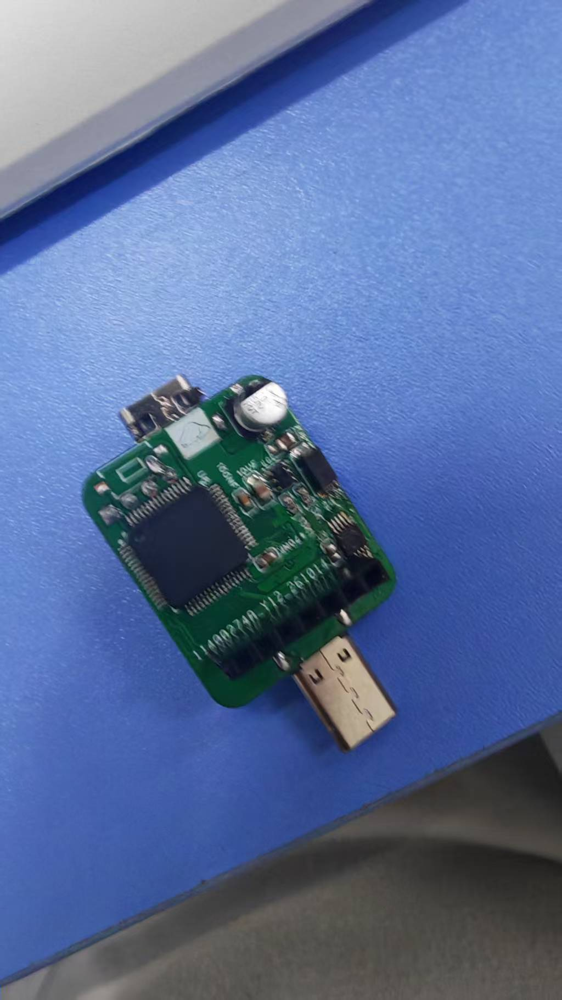
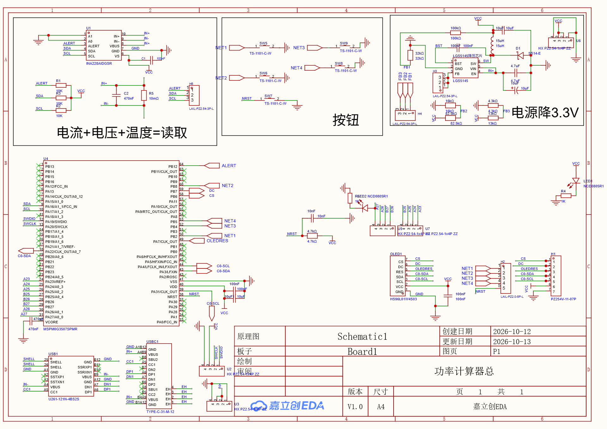

# 功率计算器总 · 硬件工程 + 固件 + 下载失败排查

嘉立创EDA专业版工程 **「功率计算器总」** 的版本留档，配套 MSPM0G3507 固件工程，以及一次
`J-Link - Cortex-M Error: No Cortex-M SW Device Found` / `Flash Download failed - "Cortex-M0+"` 的完整排查记录。

> 板子：USB 直插式功率计（Type-C 公头 + USB-A 公头一体），约 25 × 30 mm，2 层板。
> 主控：**TI MSPM0G3507SPMR**（LQFP-64，Cortex-M0+） ｜ 计量：**INA228AIDGSR** ｜ 显示：HS96L01W4S03（7P 排针）或 0.96"/1.9" 模块 ｜ 电源：**LGS5145** 降压到 3.3V

| 实物（主控侧） | 原理图 |
|---|---|
|  |  |

---

## 0. 根因（已确认）：**调试探头不兼容 MSPM0G3507**

下载失败**跟代码、接线、板子设计都无关**，是探头的问题。三份 J-Link 日志对比：

| 日志（时间） | 探头 | 结果 |
|---|---|---|
| `empty\keil\JLinkLog.txt`（3-23） | **J-Link V9.70，S/N `602722571`**，固件 2023-12 | ✅ `Found Cortex-M0 r0p1`，无 Error |
| `06_ui_display\keil\JLinkLog.txt`（7-26） | **ARM-OB STM32 克隆版，S/N `20090928`**，固件 **2012-08** | ❌ `Error: Failed to initialized DAP.` / `Old FW that does not support reading DPIDR via DAP jobs` |
| `ai m0改\JLinkLog.txt`（9-21，就是这次） | 同一只 ARM-OB 克隆版 `20090928` | ❌ DAP 初始化失败 → `CPU could not be halted`(×5) → `Failed to clear soft BP in RAM @ 0x20200000`(×3) → `Error: Connection to emulator lost!` |

**机理**：Keil 下载分两步 —— ① SWD 连上内核；② 把 Flash 算法 loader 放进 **RAM `0x20200000`** 跑起来去擦写 Flash。
这只 2012 年固件的 OB 克隆版缺 "DAP jobs" 支持，**连内核都 halt 不住**，第 ② 步必然失败，
报错就退化成 Keil 那句笼统的 `Flash Download failed - "Cortex-M0+"`。
而且本机装的 **J-Link V9.28 软件已经认不到这只克隆探头**（`ShowEmuList` 返回空）。

**解决（按推荐顺序）**

1. **换回 3 月那台 J-Link V9（S/N `602722571`）** —— 两个工程已把 J-Link 序列号写死成 `-U602722571`，插上即可下
2. 用 **独立 CMSIS-DAP / DAP-Link**（Keil: Debugger 改选 CMSIS-DAP，烧录算法保持 `MSPM0G1X0X_G3X0X_MAIN_128KB`）
   - 注意：天猛星开发板板载的 DAP-Link **只能烧它自己那颗 MCU**，烧 U4 得用独立探头接 U2 排针
3. 救克隆探头：`JLinkConfig.exe` 升固件（有变砖风险）、SWD 降到 1 MHz、短线、板子单独供电、勾 Connect under Reset
4. 换台电脑 / J-Flash + 正品探头

> 完整版（含"换探头后仍失败"的自查清单）见 **[firmware/README.md §10](firmware/README.md)** —— 这是原工程自带的排障笔记，比本页详细。

---

## 1. 目录结构

```
.
├─ README.md                     ← 你在这里
├─ hardware/
│  ├─ 功率计算器总.eprj2          ← 最新工程（SQLite，正文加密）
│  ├─ backups/                   ← 工程内自动备份（.epro2 = zip，内含明文 .epru）
│  ├─ photos/                    ← 实物照片
│  └─ render/                    ← 原理图 / PCB 预览图
├─ firmware/                     ← MSPM0G3507 Keil 工程（2 个：1.9"TFT / 0.96"OLED）
├─ docs/
│  ├─ 诊断-无法下载.md            ← 主报告（现象/结论/量测清单/改板建议）
│  └─ 证据-原理图与PCB核对.md     ← 从工程里抠出来的网表与铜箔证据
├─ tools/
│  ├─ eprj_tool.py               ← 解包 + 提网表 + 提 PCB 铜箔（仅标准库）
│  ├─ make_site.py               ← 生成单文件离线浏览页
│  └─ ssh_gh.cmd                 ← 沙箱里 git push 用的 ssh 包装
└─ data/                         ← 工具产出的证据（自动生成，已入库）
   ├─ sch_netlist.txt            ← 原理图网表（105 个网络）
   ├─ pcb_copper_report.txt      ← PCB 走线/焊盘网络/距离排查
   └─ eprj2_tables.txt           ← .eprj2 的 SQLite 表结构概况
```

---

## 2. 固件工程（`firmware/`）

| | **1.9" TFT（主工程）** | **0.96" OLED** |
|---|---|---|
| Keil 工程 | `ai_m0_gai.uvprojx` | `OLED版_0.96寸/ai_m0_oled.uvprojx` |
| 屏 | ST7789（TFT，软件 SPI） | SSD1306（OLED，软件 I²C） |
| 芯片 | MSPM0G3507 | 同 |
| 烧录算法 | `MSPM0G1X0X_G3X0X_MAIN_128KB`，`0x00000000` / `0x20000` | 同 |
| J-Link 探头 | `-U602722571` | `-U602722571` |
| SWD 速率 | **`-ZTIFSpeedSel5000`（5 MHz，未降）** | `-ZTIFSpeedSel1000`（1 MHz） |
| SDK | `C:\ti\mspm0_sdk_2_10_00_04` | 同 |
| 器件包 | `TexasInstruments.MSPM0G1X0X_G3X0X_DFP.1.3.1` | 同 |

**关键文件**

- `board_pins.h` —— 从立创EDA 读出的完整引脚表（U4 / LQFP-64），改接线先看这个
- `ina228.c/h` —— 软件 I²C 驱动 INA228（含 ACK 极性修正，见 README §J）
- `hw_lcd.c/h` + `lcdfont.h` —— TFT 驱动与字库（**`lcdfont.h` 必须保持 GBK/ANSI 编码**）
- `ti_msp_dl_config.c/h` + `empty.syscfg` —— SysConfig 生成的初始化
- `jlink_test.bat` / `jlink_test.jlink` —— **只读**连接自检（`si SWD` → `speed 1000` → `connect` → 读 `0x0` 与 `0x41C00000`）
- `README.md` —— 原工程的排障笔记（52 KB，含 §0 黑屏、§10 下载失败、I²C/SPI 取舍等）

**入库约定**：编译产物（`Objects/`、`*.o/*.d/*.axf/*.map/*.hex/*.htm`、`JLinkLog.txt`、`*.uvguix.*`）不入库，
遵循原工程自带的 `.gitignore`；**例外**是刻意保留了 `.uvoptx` —— 因为探头序列号、SWD 速率、
烧录算法这些"下载设置"都写在里面，是这个仓库的排查重点。厂商 PDF 数据手册（`资料/*.pdf`）不入库，只留提取的文本。

---

## 3. 板上硬件核查（已排除 & 隐患）

用工程文件 + 万用表逐项确认过，**都正常**：

- 供电/共地正常（只接 VCC+GND 时板上 LED 亮）
- `U2.1 → U8 pad12 (PA19/SWDIO)`、`U2.2 → U8 pad13 (PA20/SWCLK)` 走线端到端通
- `U8 pad40 = VCC`、`pad41 = GND`、`pad32 = VCORE + 470nF` 都对
- 符号库脚号和 TI 手册一致（pin12 = PA19/SWDIO，pin13 = PA20/SWCLK）

但**改下一版时**这几处要修（详见 [docs/诊断-无法下载.md](docs/诊断-无法下载.md)）：

1. **调试排针 U2 第 4 脚（GND）在 PCB 上没有走线**，只靠铺铜连通 → DRC 查不出来，改版容易丢。
2. **NRST 只有一颗 10nF**：原理图的 `4.7kΩ 上拉 + SW7 复位键 + H2 排针` 没落到 PCB。
3. **3.3V 反馈网络原理图与 PCB 不一致**：原理图上 `LGS5145-FB` 只连到 H3 三个**被短接**的脚（反馈环开路），
   分压中点 `FB1/FB2/FB3` 只到 H4；PCB 上是 `13K1/3K1`（5.23×），对应输出约 4.18V（若基准 0.8V）—— 必须实测 VCC。
4. **没有引出 UART**（PA10/PA11 未接），也没有 USB-串口芯片 → 想"读端口"只能从 H5 的 I²C 或屏接口想办法；M0+ 没有 SWO。

---

## 4. 引脚 / 接线速查

### MCU（原理图 U4 / PCB U8，MSPM0G3507SPMR）

| 功能 | pad | 说明 |
|---|---|---|
| SWDIO | 12 | PA19/SWDIO → U2.1 |
| SWCLK | 13 | PA20/SWCLK → U2.2 |
| NRST | 38 | 10nF 到地（PCB 无上拉/按键） |
| VDD | 40 | VCC |
| VSS | 41 | GND |
| VCORE | 32 | 只接 470nF 到地 |
| SDA / SCL | 9 / 10 | PA16/PA17 → INA228 + H5 + 10k 上拉 |
| C0-SDA / C0-SCL | 43 / 44 | 屏的 I²C |

### 调试排针 U2（HDR-TH_4P-P2.54，封装 tag 写着 SWD）

| U2 | 网络 | 通用 4P SWD 线序 |
|---|---|---|
| 1 | **SWDIO** | 1 = 3V3 |
| 2 | **SWCLK** | 2 = SWDIO |
| 3 | **VCC** | 3 = SWCLK |
| 4 | **GND** | 4 = GND |

> ⚠️ **不能 1:1 直插**：1:1 时地是对的、电也照进（LED 会亮），但 SWDIO/SWCLK 全错。
> ⚠️ LED 接在 VCC 轨上，**它亮只说明 3.3V 有电，不代表 MCU 活着**；判芯片是否在线看
> `Options → Debug → Settings` 里的 `SW Device`（应显示 `ARM CoreSight SW-DP` + `IDCODE 0x6BA02477`）。

---

## 5. 怎么复现分析

工程 `.eprj2` 的正文是加密的，**连接性分析一律走 `backups/*.epro2`**（zip 里的 `.epru` 是明文）：

```bash
python tools/eprj_tool.py unpack hardware/backups/功率计算器总_2026-10-19-20-33.epro2 -o build/
python tools/eprj_tool.py netlist build/功率计算器总.epru -o data/sch_netlist.txt
python tools/eprj_tool.py pcb     build/功率计算器总.epru -o data/pcb_copper_report.txt
```

只依赖 Python 标准库（3.8+）。离线浏览页：`python tools/make_site.py -o view.html`。

---

## 6. 推送到 GitHub

远程：`ssh://git@ssh.github.com:443/huanghongxin886/power-calc-board.git`（本机 22 端口被封，走 443）。

```powershell
cd "D:\deepseekH--Work\功率计算器总"
$env:GIT_SSH = "$PWD\tools\ssh_gh.cmd"     # 沙箱里 sh.exe 起不来，必须用这个包装
git add -A; git commit -m "..."; git push
```

---

## 7. 备份时间线

| 备份 | 说明 |
|---|---|
| 10-13 13:46 → 22:25（6 份） | 当天下午到晚上的连续改动（PCB 逐步布线） |
| **10-19 20:33** | 最新。相比 10-13：元件 29→28（删掉一颗 7K），走线 348→352，过孔 56→54 |

工程文件 `功率计算器总.eprj2` 修改时间：2026-10-19 20:34。
